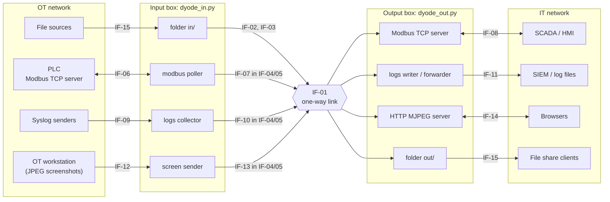
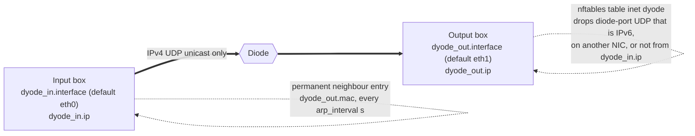
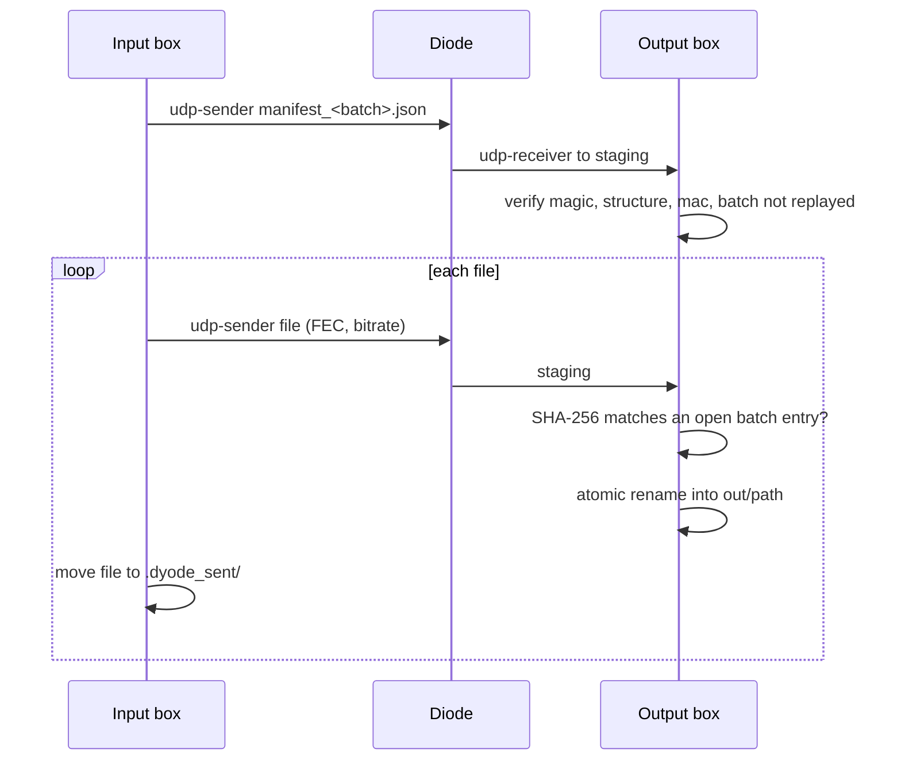

# DYODE (Python 3 port): Interface Control Document

| | |
|---|---|
| **Document title** | DYODE Interface Control Document (detailed design) |
| **Interfacing systems** | System 1: DYODE input box (OT side), `dyode_in.py`. System 2: DYODE output box (IT side), `dyode_out.py` |
| **Document number** | DYODE-ICD-001 |
| **Version** | 0.1 (draft) |
| **Date** | 2026-11-05 |
| **Author** | Nick Carter (Intezra) |
| **Software baseline** | DYODE 1.5.0 (`VERSION`), commit `a4d8f66` on `master` |
| **Classification** | TBC (see OI-01) |

The structure follows the Crossrail "Detailed Design Interface Control
Document Template" (7G-007): document history, review status and sign-off,
then 1 Introduction, 2 Interface Specifications and Agreements, 3
Verification and Validation. Sub-sections under section 2 are this
document's own, as the template allows.

## Document History

| Revision | Date | Prepared by | Checked by | Approved by | Reason for Issue |
|---|---|---|---|---|---|
| 0.1 | 2026-11-05 | Nick Carter (Intezra) | TBC | TBC | First draft for review |

## Review and Acceptance Status

| Code | Meaning |
|---|---|
| 1 | Accepted. Work may proceed. |
| 2 | Not accepted. Revise and resubmit. Work may proceed with the changes noted. |
| 3 | Not accepted. Revise and resubmit. Work may not proceed. |
| 4 | Received for information only. |

| Status code | Reviewer | Name | Date |
|---|---|---|---|
| (pending) | | | |

## Interface Control Document Sign-Off

**Reviewed by**

| Name | Role | Organisation | Signature | Date |
|---|---|---|---|---|
| | | | | |

**Agreed by**

| Party | Name | Role | Organisation | Signature | Date |
|---|---|---|---|---|---|
| Input box (OT side) owner | TBC | | | | |
| Output box (IT side) owner | TBC | | | | |

## Contents

1. [Introduction](#1-introduction)
   1. [Purpose of the Document](#11-purpose-of-the-document)
   2. [Current Status](#12-current-status)
   3. [Interfaces Covered by this Document](#13-interfaces-covered-by-this-document)
   4. [Definitions and Abbreviations](#14-definitions-and-abbreviations)
   5. [References](#15-references)
2. [Interface Specifications and Agreements](#2-interface-specifications-and-agreements)
   1. [Interface Register](#21-interface-register)
   2. [IF-01 One-way network link](#22-if-01-one-way-network-link)
   3. [IF-02 Folder transfer (udpcast) and IF-03 manifest](#23-if-02-folder-transfer-udpcast-and-if-03-batch-manifest)
   4. [IF-04 DYO1 message framing and IF-05 DYA1 authentication](#24-if-04-dyo1-message-framing-and-if-05-dya1-message-authentication)
   5. [IF-06 to IF-08 Modbus](#25-if-06-to-if-08-modbus-mirroring)
   6. [IF-09 to IF-11 Log streaming](#26-if-09-to-if-11-log-streaming)
   7. [IF-12 to IF-14 Screen sharing](#27-if-12-to-if-14-screen-sharing)
   8. [IF-15 Filesystem interfaces](#28-if-15-filesystem-interfaces)
   9. [IF-16 Configuration file and IF-17 key file](#29-if-16-configuration-file-and-if-17-shared-key-file)
   10. [IF-18 Logging and events](#210-if-18-logging-and-events)
   11. [IF-19 Host platform and dependencies](#211-if-19-host-platform-and-dependencies)
   12. [IF-20 DYODE v2 serial link](#212-if-20-dyode-v2-serial-link)
   13. [Interface Requirements](#213-interface-requirements)
3. [Verification and Validation](#3-verification-and-validation)
4. [Open Issues](#4-open-issues)

---

## 1 Introduction

### 1.1 Purpose of the Document

This document defines and controls every interface of the DYODE data diode
software. It covers the interface between the input box and the output box,
and the interfaces each box offers to its own network, its filesystem, its
operating system and its operators. It records what each side must send,
what the other side must accept, and how each requirement is verified.

All values come from the 1.5.0 source code and its documentation. Anything
that could not be confirmed from them is marked **TBC** and listed in
[section 4](#4-open-issues).

### 1.2 Current Status

Version 0.1 is a first draft. It describes DYODE 1.5.0 as built. Nobody has
reviewed or agreed it yet. Open issues remain (section 4).

### 1.3 Interfaces Covered by this Document



Cross-cutting interfaces on both boxes: IF-16 `config.yaml`, IF-17
`dyode.key`, IF-18 logs and JSON events, IF-19 host platform. IF-20 covers
the DYODE v2 serial link.

Out of scope: the physical diode hardware itself (fibre or optocoupler), the
v2 PCB (`DYODE_v2_light/hardware/`), and the internals of the PLC, SIEM and
SCADA systems.

### 1.4 Definitions and Abbreviations

| Term | Definition |
|---|---|
| Input box | Host on the OT side that runs `dyode_in.py` and only sends through the diode |
| Output box | Host on the IT side that runs `dyode_out.py` and only receives through the diode |
| Diode | Hardware link that physically carries data in one direction only |
| Batch | Set of files announced by one manifest |
| DYO1 | DYODE's UDP datagram framing (magic `DYO1`) |
| DYA1 | DYODE's signed message envelope (magic `DYA1`) |
| DYLG | Log-stream payload header (magic `DYLG`) |
| FEC | Forward error correction (udpcast `--fec`) |
| HMAC | Hash-based message authentication code, here HMAC-SHA256 |
| ICD | Interface Control Document |
| IF-nn | Interface identifier in this document |
| IR-nn | Interface requirement identifier in this document |
| MJPEG | Motion JPEG over HTTP (`multipart/x-mixed-replace`) |
| OT / IT | Operational technology (plant) / information technology (office) network |
| PLC | Programmable logic controller |
| SIEM | Security information and event management system |
| TBC | To be confirmed |

### 1.5 References

| Ref | Document | Location |
|---|---|---|
| R1 | Crossrail ICD template 7G-007 | learninglegacy.crossrail.co.uk |
| R2 | Architecture | `docs/wiki/Architecture.md` |
| R3 | Configuration Reference | `docs/wiki/Configuration-Reference.md` |
| R4 | Folder Transfers | `docs/wiki/Folder-Transfers.md` |
| R5 | Modbus Mirroring | `docs/wiki/Modbus-Mirroring.md` |
| R6 | Log Streaming | `docs/wiki/Log-Streaming.md`, `DYODE_v1_full/LOG_STREAMING.md` |
| R7 | Screen Sharing | `docs/wiki/Screen-Sharing.md` |
| R8 | Security | `docs/wiki/Security.md` |
| R9 | Installation and Setup | `docs/wiki/Installation-and-Setup.md` |
| R10 | Caveats | `CAVEATS.md` |
| R11 | Change log | `CHANGELOG.md` |
| R12 | Example configuration | `DYODE_v1_full/config.example.yaml` |
| R13 | Source code | `DYODE_v1_full/dyode.py`, `dyode_common.py`, `modbus.py`, `logstream.py`, `screen.py`, `dyode_setup_core.py`, `install.sh`, `lib/*.sh` |
| R14 | udpcast manual pages | `udp-sender(1)`, `udp-receiver(1)` |

---

## 2 Interface Specifications and Agreements

### 2.1 Interface Register

| I/F number | Descriptor (type) | System 1: input box | System 2: output box | Document reference(s) | Notes |
|---|---|---|---|---|---|
| IF-01 | One-way IPv4 link through the diode (physical / network) | Diode NIC `dyode_in.interface`, `dyode_in.ip`; static neighbour for `dyode_out.mac` | Diode NIC `dyode_out.interface`, `dyode_out.ip`; nftables `inet dyode` | R2, R8 | Unicast only |
| IF-02 | Bulk file transport, udpcast (data) | `udp-sender --async` | `udp-receiver --nosync` | R4, `dyode.py` | Per `folder` module |
| IF-03 | Batch manifest `dyode-manifest-v1` (data) | `build_manifest()` | `read_manifest()`, batch tracker | R4, `dyode.py` | Signed with IF-05 key |
| IF-04 | DYO1 datagram framing (data) | `udp_chunks()`, `udp_send()` | `Reassembler` | R2, `dyode_common.py` | Carries IF-07, IF-10, IF-13 |
| IF-05 | DYA1 message authentication (security) | `MessageAuth.seal()` | `MessageAuth.open()` | R8, `dyode_common.py` | HMAC-SHA256 |
| IF-06 | Modbus TCP client to PLC (external, OT) | `modbus.py` poller | n/a | R5 | |
| IF-07 | Modbus update message (data) | Poller snapshot | Mirror datastore | R5, `modbus.py` | JSON in IF-04/05 |
| IF-08 | Modbus TCP server to SCADA (external, IT) | n/a | Read-only server, `port_out` | R5 | |
| IF-09 | Log sources: syslog UDP/TCP and file tail (external, OT) | `logstream.py` | n/a | R6 | |
| IF-10 | Log batch `DYLG` v1 (data) | Batch builder | Dedup, reorder, gap detection | R6, `logstream.py` | In IF-04/05 |
| IF-11 | Log destinations: files and forwarding (external, IT) | n/a | `received.log`, `udp://`, `tcp://` | R6 | |
| IF-12 | Screenshot drop folder (external, OT) | `screen.py` watcher | n/a | R7 | `screenshot.ps1` |
| IF-13 | Screen frame message (data) | Newest JPEG | Latest complete frame | R7, `screen.py` | In IF-04/05 |
| IF-14 | HTTP viewer (external, IT) | n/a | `/`, `/screen.mjpg`, `/screen.jpg` | R7 | |
| IF-15 | Filesystem: watched, staging, delivery folders, file shares (filesystem) | `in/`, `.dyode_sent/` | `<out>.incoming`, `out/`, NFS/SMB exports | R4, R9 | |
| IF-16 | `config.yaml` (configuration) | Same file | Same file | R3, R12 | Identical on both boxes |
| IF-17 | `dyode.key` (security / configuration) | Same file | Same file | R8 | Mode 0600 |
| IF-18 | Human log, JSON events, archives (operations) | `dyode.log`, `transfer.jsonl`, stderr | Same | `dyode_common.py`, `dyode_logs.py` | |
| IF-19 | Host OS, packages, services (platform) | systemd `dyode-in.service` | systemd `dyode-out.service`, `dyode-firewall.service` | R9, `install.sh` | |
| IF-20 | DYODE v2 serial link through optocoupler (physical / data) | `serial.device` writer | `serial.device` reader | R5, `dyode_common.py` | Modbus only, unsigned |

### 2.2 IF-01 One-way network link



| Parameter | Value | Source |
|---|---|---|
| Direction | Input box to output box only | R2 |
| Network layer | IPv4. Diode-port traffic over IPv6 is dropped by the firewall. | R8 |
| Transport | UDP only | R2 |
| Addressing | Unicast to `dyode_out.ip`. udpcast is given `--mcast-rdv-addr` and `--mcast-data-addr` set to the peer's unicast address, so no multicast group is used. | `dyode.py` lines 150-165 |
| Link-layer resolution | No ARP reply can return. The input box pins `dyode_out.mac` as a permanent neighbour entry (iproute2) and re-asserts it every `arp_interval` s (default 60). `dyode_in.py` refuses to start if this fails. | R2 |
| Ports | One UDP port per module (`modules.*.port`); folder modules use it as the udpcast port base | R3 |
| MTU | Standard 1500-byte Ethernet assumed. DYO1 payload is at most 1400 B per datagram, so there is no IP fragmentation. Jumbo frames: TBC (OI-04). | `dyode_common.py` |
| Bandwidth sharing | Folder: `bitrate` per module (default 8 Mbit/s split across folder modules). Logs: `max_kbps` (default 2000). Modbus and screen: no explicit cap; datagrams are paced 0.2 ms apart. | R3, `dyode_common.udp_send` |
| Receive tuning | `/etc/sysctl.d/90-dyode-receive.conf`: `net.core.rmem_default = 8388608`, `net.core.rmem_max = 16777216` | `lib/install-tuning.sh` |
| Physical medium | Fibre or optocoupler; specific diode hardware TBC (OI-03) | R2 |

### 2.3 IF-02 Folder transfer (udpcast) and IF-03 batch manifest

**IF-02 udpcast invocation** (`dyode.py`):

```
udp-sender --async --nokbd [--fec <fec>] --max-bitrate <bitrate>m \
  --mcast-rdv-addr <dyode_out.ip> --mcast-data-addr <dyode_out.ip> \
  --portbase <port> --autostart <autostart> --interface <dyode_in.interface> -f <file>

udp-receiver --nosync --nokbd --mcast-rdv-addr <dyode_in.ip> \
  --interface <dyode_out.interface> --portbase <port> [--start-timeout <start_timeout>]
```

| Parameter | Default | Meaning |
|---|---|---|
| `port` | required | udpcast `--portbase`, unique per module |
| `bitrate` | 8 Mbit/s ÷ number of folder modules | `--max-bitrate`, includes FEC and headers |
| `fec` | `8x16/64` | 8 interleaved stripes, 16 repair blocks per 64 data blocks; `none` disables it |
| `autostart` | 5 | Hello packets before data; the receiver's only grace period |
| `start_timeout` | 300 s | Receiver idle timeout; `0` waits forever |
| `settle` | 2 s | File must be unchanged this long before sending |
| `file_gap` | 0.5 s | Pause between files so the receiver can restart |
| `batch_timeout` | 300 s | Close an incomplete batch after this long with nothing arriving |
| `keep_sent_hours` | 24 | Retention of sent files in `.dyode_sent/` |

One udpcast session carries one file. The manifest goes first, then each
file. The receiver matches files to manifest entries by SHA-256, not by
arrival order. Up to four batches stay open at once.

**IF-03 manifest** (JSON file, sent as its own udpcast transfer):

```json
{
  "magic": "dyode-manifest-v1",
  "batch": "<uuid4 hex>",
  "files": [ {"path": "sub/b.bin", "size": 1234, "sha256": "<64 hex>"} ],
  "mac": "<hex HMAC-SHA256>"
}
```

| Field | Rule |
|---|---|
| `magic` | Must equal `dyode-manifest-v1` |
| `batch` | Random UUID4 hex. Recently seen batch ids are refused (replay). |
| `files[].path` | Relative path. Absolute paths, `..` and `.dyode*` components are refused. |
| `files[].size`, `files[].sha256` | Size in bytes and SHA-256 hex of the file content |
| `mac` | HMAC-SHA256 (IF-17 key) over the canonical text: the manifest without `mac`, `json.dumps(sort_keys=True, separators=(",", ":"), ensure_ascii=True)`. Required unless `auth.required: false`. |



### 2.4 IF-04 DYO1 message framing and IF-05 DYA1 message authentication

Used by the modbus, logs and screen modules. A message is first sealed
(IF-05), then split into datagrams (IF-04).

**IF-04 DYO1 datagram** (big-endian, `struct ">4sIHHI"`, 16-byte header):

| Offset | Size | Field | Value |
|---|---|---|---|
| 0 | 4 | magic | `DYO1` |
| 4 | 4 | msg_id | Random u32 per message |
| 8 | 2 | index | 0 to total-1 |
| 10 | 2 | total | Number of datagrams, 1 to 65535 |
| 12 | 4 | crc32 | zlib CRC32 of the whole (sealed) message |
| 16 | ≤1400 | piece | Message bytes |

Receiver limits (`Reassembler` defaults): at most 8 pending messages, 1024
pieces per message, 32 MiB held, 10 s age for a partial message. Datagrams
shorter than 16 B or longer than 1416 B are ignored. A message with a missing
piece or a CRC mismatch is dropped whole. Receiving sockets are bound to
`dyode_out.ip` and to the diode NIC (`SO_BINDTODEVICE`).

**IF-05 DYA1 envelope**:

| Offset | Size | Field |
|---|---|---|
| 0 | 4 | magic `DYA1` |
| 4 | 8 | boot id, random per sender process |
| 12 | 8 | counter, u64, increments per message |
| 20 | n | message |
| 20+n | 32 | HMAC-SHA256 over bytes 0 to 20+n, with the `dyode.key` key |

The receiver accepts a counter once per boot id, within a 4096-message
window, tracking at most 8 boot ids. Rejections are counted and logged at
most once a minute.


### 2.5 IF-06 to IF-08 Modbus mirroring

| Item | IF-06 PLC side (input box) | IF-08 SCADA side (output box) |
|---|---|---|
| Protocol | Modbus TCP client (pymodbus 3.12) | Modbus TCP server (pymodbus 3.12) |
| Address | `ip`:`plc_port` (default 502), unit `unit` (default 1) | `bind_out` (default `0.0.0.0`):`port_out` (default 502) |
| Data | Holding registers (`registers`) and coils (`coils`); ranges `start-end`, end excluded | Same ranges |
| Timing | Poll every `interval` (1.0 s); requests split at 125 registers / 2000 coils | `stale_after` (10 s) without updates logs a warning; last values still served |
| Writes | Read-only towards the PLC | Every write refused with exception 01 |
| Unmapped reads | n/a | Exception 02, or 0 with `unmapped: zero` |

**IF-07 update message** (compact JSON, inside IF-05/IF-04, to UDP `port`):

```json
{"module": "<name>", "seq": 42, "time": 1762300000.0,
 "registers": { ... }, "coils": { ... }}
```

The exact encoding inside `registers` and `coils` (address keys and value
lists) is TBC (OI-05). Updates outside the configured datastore are
rejected and logged.

### 2.6 IF-09 to IF-11 Log streaming

| Item | Value |
|---|---|
| IF-09 sources | `listen_udp` (syslog over UDP, e.g. `514` or `"10.0.0.1:514"`), `listen_tcp` (syslog over TCP, LF or RFC 6587 octet counting), `tail` (file globs, rotation-aware, offsets in `tail_state`, start `tail_from: end`). `allow_from` restricts sender networks. At least one source required. |
| IF-10 wire format | `b"DYLG"` + version byte `0x01` + zlib (level 6) of JSON `{"b": boot id, "s": seq, "t": send time, "d": dropped so far, "l": [[ts, src, chan, msg], ...]}`, inside IF-05/IF-04 |
| IF-10 reliability | Each batch sent `copies` times (default 2, range 1-4) about 0.5 s apart; heartbeats every `heartbeat` s (10); cap `max_kbps` (2000) |
| IF-11 destinations | `out`: `received.log` (or one file per host with `split_by_source`); `forward`: `udp://host:port` or `tcp://host:port`. `format`: `prefixed` (default), `raw`, `json`. At least one destination required. |
| Output detection | Duplicates dropped, reorder window, gaps logged (`logs_gap`), sender restart (`logs_sender_restart`), silence after `stale_after` (30 s) (`logs_stale`) |

### 2.7 IF-12 to IF-14 Screen sharing

| Item | Value |
|---|---|
| IF-12 input | Folder `in` of JPEG files written by an OT workstation (`screenshot.ps1` for Windows). Only files starting with the JPEG magic are sent. Image size and naming limits: TBC (OI-06). |
| IF-13 message | Raw bytes of the newest JPEG, inside IF-05/IF-04, at most `max_fps` (10) per second; superseded images skipped |
| IF-14 HTTP | `http_bind` (default: first address not on the diode NIC):`http_port` (8080). `GET /` page, `GET /screen.mjpg` MJPEG stream, `GET /screen.jpg` still. At most `max_streams` (8) viewers, then HTTP 503. No input path back. |

### 2.8 IF-15 Filesystem interfaces

| Path | Box | Rule |
|---|---|---|
| `in/` (folder module) | Input | Watched with inotify plus a 30 s rescan. Symbolic links never followed or sent. |
| `in/.dyode_sent/` | Input | Sent files kept `keep_sent_hours`; copy back to `in/` to resend |
| Staging (`staging`, default `<out>.incoming`) | Output | Must be outside `out/` and on the same filesystem (atomic rename) |
| `out/` (folder module) | Output | Only verified files appear; never placed through a symlink |
| Screen `in` | Input | JPEG drop folder |
| Logs `out` | Output | `received.log`, logrotate-friendly |
| `/var/log/dyode-transfer/` | Both | IF-18 |
| `/etc/dyode/firewall.nft` | Output | Generated firewall rules |
| File shares | Either | Optional NFS/SMB exports by `install.sh` (`lib/install-shares.sh`); folders inside a larger filesystem exported with `subtree_check` |

Services run as `User=root` (generated systemd unit). Required ownership and
modes for `in/` and `out/` beyond this are TBC (OI-07).

### 2.9 IF-16 Configuration file and IF-17 shared key file

`config.yaml` is identical on both boxes and fully validated at start-up;
unknown or invalid values stop the program with a message.

| Key | Type / default | Notes |
|---|---|---|
| `config_name`, `config_version`, `config_date` | labels | Logged at start-up |
| `dyode_in.ip`, `.mac`, `.interface` (eth0), `.arp_interval` (60) | | IF-01 |
| `dyode_out.ip`, `.mac`, `.interface` (eth1) | | IF-01 |
| `auth.key_file` (`dyode.key`), `auth.required` (true) | | IF-17 |
| `logging.dir` (`/var/log/dyode-transfer`), `.human` (`dyode.log`), `.json` (`transfer.jsonl`), `.per_file_events` (true) | | IF-18 |
| `serial.device` (`/dev/serial0`), `serial.baudrate` (57600) | v2 only | IF-20 |
| `modules.<name>.type` | `folder`, `modbus`, `logs`, `screen` (case-insensitive) | Keys per type in sections 2.3, 2.5-2.7 |
| `modules.<name>.port` | integer, required, unique | IF-01 |

IF-17 `dyode.key`: a random secret file beside `config.yaml`, mode 0600,
created with `python3 dyode_setup.py --new-key` or the setup wizard, and
copied to the second box by removable media. Key length and encoding: TBC
(OI-08).

### 2.10 IF-18 Logging and events

| Output | Format |
|---|---|
| stderr / journald | Human-readable, always |
| `<dir>/dyode.log` | Human-readable, all modules |
| `<dir>/transfer.jsonl` | One JSON object per line |
| `<dir>/archive/dyode-logs-<YYYY>-W<ww>.tar.gz` | Weekly archive by `dyode_logs.py --archive` (`dyode-log-archive.timer`) |

Event names emitted by `log_event()`: `manifest_received`,
`manifest_rejected`, `batch_sent`, `batch_received`, `batch_failed`,
`file_sent`, `file_skipped`, `file_stored`, `file_rejected`,
`file_missing`, `file_orphaned`, `logs_gap`, `logs_resumed`,
`logs_sender_restart`, `logs_stale`, `logs_stats`,
`logs_dropped_at_source`. Per-file events are suppressed with
`per_file_events: false`. The common field set of an event record is TBC
(OI-09). Rotation is by `packaging/logrotate/dyode-transfer`.

### 2.11 IF-19 Host platform and dependencies

| Item | Value |
|---|---|
| Supported OS | Ubuntu 24.04 and 26.04 LTS (amd64, arm64); Raspberry Pi OS 12 and 13, 64-bit (arm64). Offline `.deb` bundles also for Debian 12 and 13 (`packaging/debs`); Debian support status TBC (OI-10). |
| Python | 3.11 to 3.14 |
| Python packages | PyYAML ≥ 6.0, pymodbus ≥ 3.12, < 3.13, inotify_simple ≥ 1.3, pyserial (v2) |
| OS packages | `udpcast`, `iproute2`, `nftables` (output box firewall), python3-venv |
| Services | `dyode-in.service` / `dyode-out.service` (`Restart=always`, `BindsTo=` the diode NIC), `dyode-firewall.service`, `dyode-log-archive.timer` |
| Supervision | Each module runs in its own process; restart after a 5 s guard |

### 2.12 IF-20 DYODE v2 serial link

| Item | Value |
|---|---|
| Medium | Serial line through an optocoupler, `serial.device` (`/dev/serial0`), `baudrate` 57600, same on both sides |
| Framing | One message per line: 8 hex digits of CRC32, a space, compact JSON, `\n`. Lines over 4 MiB discarded. |
| Content | Modbus updates (IF-07) tagged with the module name; other module types ignored with a warning |
| Authentication | None (point-to-point, physically one-way) |

### 2.13 Interface Requirements

Verification methods: **T** test (automated, `tests/`), **D**
demonstration, **I** inspection, **A** analysis.

| Req ID | Interface | Requirement | Method |
|---|---|---|---|
| IR-01 | IF-01 | The output box shall not send any packet towards the input box through the diode. | I (hardware), D |
| IR-02 | IF-01 | The input box shall refuse to start if the static neighbour entry for `dyode_out.mac` cannot be set, and shall re-assert it every `arp_interval` s. | T, D |
| IR-03 | IF-01 | The output box shall drop diode-port UDP that arrives over IPv6, on another NIC, or from an address other than `dyode_in.ip`. | T (`test_install`), D (`nft list table inet dyode`) |
| IR-04 | IF-02 | Each folder module shall transmit at no more than its configured `bitrate`. | D, A |
| IR-05 | IF-02 | Files shall be sent only after being unchanged for `settle` s; symbolic links shall never be sent. | T (`test_folder`) |
| IR-06 | IF-03 | The output box shall place a file in `out/` only if its SHA-256 and size match an entry of an open, validly signed manifest. | T (`test_folder`, `test_security`) |
| IR-07 | IF-03 | Manifest paths that are absolute, contain `..` or a `.dyode*` component shall be refused. | T |
| IR-08 | IF-03 | Files missing when a batch closes shall each be named in the log and as `file_missing` events. | T |
| IR-09 | IF-04 | No DYO1 datagram shall exceed 1416 bytes of UDP payload. | T (`test_common`), A |
| IR-10 | IF-04 | A message with a missing piece or a CRC32 mismatch shall be dropped whole. | T |
| IR-11 | IF-04 | Reassembly memory per listener shall not exceed 32 MiB. | T |
| IR-12 | IF-05 | Messages without a valid HMAC, or replayed within the window, shall be rejected and counted. | T (`test_security`) |
| IR-13 | IF-05, IF-17 | Both boxes shall refuse to start without `dyode.key` unless `auth.required: false`. | T, D |
| IR-14 | IF-06 | The input box shall only read from the PLC, never write. | I (code), T (`test_modbus`) |
| IR-15 | IF-08 | The output Modbus server shall answer every write with exception 01 and unmapped reads with exception 02 (or 0 with `unmapped: zero`). | T |
| IR-16 | IF-08 | The output box shall log a warning after `stale_after` s without updates. | T |
| IR-17 | IF-10 | Lost log batches shall be reported as `logs_gap`; duplicates shall be discarded. | T (`test_logstream`) |
| IR-18 | IF-09 | When `allow_from` is set, syslog from other networks shall be ignored. | T |
| IR-19 | IF-14 | The viewer shall bind to the IT-side address by default and refuse viewers beyond `max_streams` with HTTP 503. | T (`test_screen`) |
| IR-20 | IF-15 | Staging shall be outside `out/` and on the same filesystem; files shall appear in `out/` atomically. | T, I |
| IR-21 | IF-16 | An invalid `config.yaml` shall stop start-up with a clear error. | T (`test_common`, `test_setup`) |
| IR-22 | IF-18 | Transfer events shall be written one JSON object per line to `transfer.jsonl`. | T (`test_logging`) |
| IR-23 | IF-19 | The software shall install offline from the bundled packages on each supported OS. | D (`install.sh`), T (`test_install`) |
| IR-24 | IF-20 | Damaged serial lines (CRC mismatch) shall be discarded. | T |

---

## 3 Verification and Validation

| Stage | Activity | Covers |
|---|---|---|
| Unit and integration tests | `tests/` (pytest): `test_common`, `test_folder`, `test_modbus`, `test_logstream`, `test_screen`, `test_security`, `test_logging`, `test_setup`, `test_install`, `test_shares`, `test_tuning`, `test_layout` | IR marked T |
| Inspection | Code review against this ICD; review of `config.yaml`, key file mode, generated systemd unit and firewall | IR marked I |
| Demonstration | On a pair of boxes joined by the real diode: send a batch of files (including large ones), mirror a PLC, stream syslog, view the screen; check `transfer.jsonl` and `nft` counters | IR marked D |
| Analysis | Bandwidth budget across modules versus link rate and FEC overhead | IR-04, IR-09 |

Acceptance criteria per site (link rate, file sizes, loss tolerance) are TBC
(OI-11). The mapping of individual tests to each IR is TBC (OI-12).

---

## 4 Open Issues

| ID | Item | Interface | Status |
|---|---|---|---|
| OI-01 | Document classification and distribution | All | TBC |
| OI-02 | Checker, approver and agreeing parties for sign-off | All | TBC |
| OI-03 | Diode hardware model, medium and rated throughput | IF-01 | TBC |
| OI-04 | Behaviour and support with jumbo frames or MTU below 1500 | IF-01, IF-04 | TBC |
| OI-05 | Exact JSON encoding of `registers` / `coils` in Modbus updates | IF-07 | TBC |
| OI-06 | Maximum screenshot size (bounded by 1024 pieces × 1400 B ≈ 1.4 MB unless the screen listener sets other limits) and file naming | IF-12, IF-13 | TBC |
| OI-07 | Required ownership and permissions for `in/`, `out/`, staging and share users | IF-15 | TBC |
| OI-08 | `dyode.key` length and encoding | IF-17 | TBC |
| OI-09 | Common field set of `transfer.jsonl` event records | IF-18 | TBC |
| OI-10 | Whether Debian 12 / 13 are supported platforms (bundles exist, not listed in R9) | IF-19 | TBC |
| OI-11 | Site acceptance criteria (throughput, loss, latency) | All | TBC |
| OI-12 | Traceability of each test case to each IR | Section 3 | TBC |
| OI-13 | udpcast uses more than one UDP port from `--portbase`; whether the firewall and port-uniqueness check cover every port used | IF-01, IF-02 | TBC |
