# Data Flows

This page follows every kind of data through DYODE v1, end to end: from the
moment the input box starts, through the one-way link, to the moment the
data is usable on the output box. It also shows what happens when something
is lost or rejected, and what each side writes to its log when that happens.

Everything here is taken from the code in `DYODE_v1_full/`. Names in
`code` are config keys, functions or log events you can search for.

- [Overall flow and start-up](#overall-flow-and-start-up)
- [Folder transfer flow](#folder-transfer-flow)
- [Modbus mirroring flow](#modbus-mirroring-flow)
- [Log streaming flow](#log-streaming-flow)
- [Screen sharing flow](#screen-sharing-flow)
- [Error and loss handling](#error-and-loss-handling)

## Overall flow and start-up

Both boxes read the **same `config.yaml`**. The input box runs
`dyode_in.py`, the output box runs `dyode_out.py`. Each starts one process
per module, and every module on the input box sends UDP to `dyode_out.ip`
on the module's own `port`.

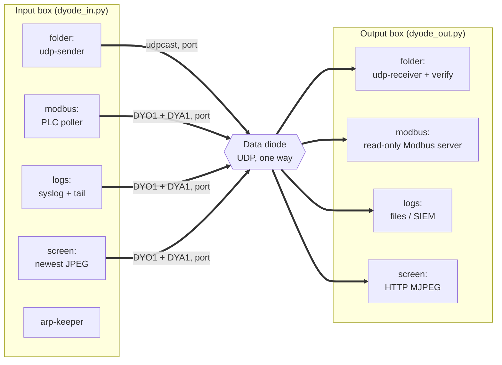

Folder modules use udpcast. The other three use DYODE's own framing: each
message is signed (`DYA1`: sender id, counter, HMAC-SHA256) and then split
into `DYO1` datagrams of at most 1400 bytes with a CRC32 of the whole
message. See [Architecture](Architecture#two-transports).

### Start-up and config loading

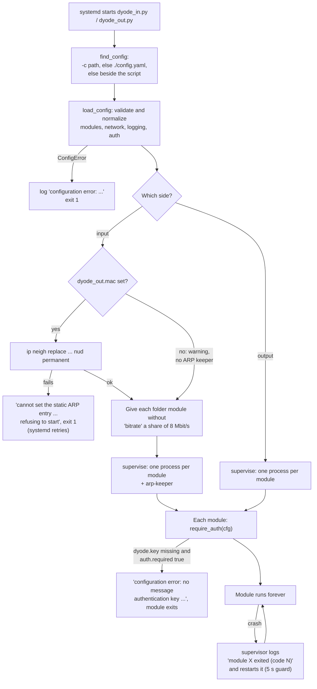

What `load_config` does:

- Lower-cases each module's `type` and checks it is `folder`, `modbus`,
  `logs` or `screen`; `port` is required for every module.
- Builds a `network` section from `dyode_in` / `dyode_out`, with defaults
  `10.0.1.1` / `10.0.1.2`, `eth0` / `eth1`, and `arp_interval` 60 s.
- For `folder` modules, fills in defaults: `fec` `8x16/64` (or off for
  `none`, `off`, `false`, `no`, `0`, `disabled`), `file_gap` 0.5 s,
  `keep_sent_hours` 24, `batch_timeout` 300 s, `autostart` 5,
  `start_timeout` 300 s. A `staging` folder must be absolute and must not be
  inside `out`.
- For `modbus`, parses `registers` / `coils` ranges (end excluded) and
  checks `unmapped` is `exception` or `zero`.
- For `logs`, `logstream.normalize_props` checks sources and destinations
  and raises `reorder_window` to at least the time all `copies` need.
- Resolves `auth.key_file` relative to the config file's folder.

Any validation error stops the program before a single module starts. The
key file is checked later, by each module as it starts.

## Folder transfer flow

### Input side: watching and batching

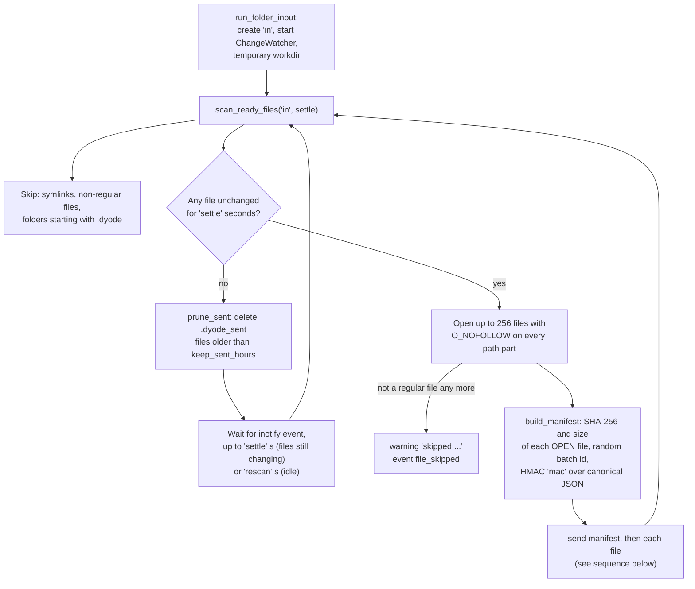

Without `inotify_simple` installed, the watcher logs a warning and polls
instead. Files left over in `in` are picked up at start-up.

The manifest is JSON:
`{"magic": "dyode-manifest-v1", "batch": <hex id>, "files": [{"path", "size", "sha256"}, ...], "mac": <hex HMAC>}`.
The HMAC covers every field except `mac`, serialized with sorted keys.

### udpcast invocation

Each file, and the manifest itself, is one separate udpcast transfer.
Arguments are passed as a list, never through a shell.

Sender (input box), per file:

```
udp-sender --async --nokbd [--fec <fec>] --max-bitrate <bitrate>m
           --mcast-rdv-addr <out_ip> --mcast-data-addr <out_ip>
           --portbase <port> --autostart <autostart>
           --interface <in_interface> -f /proc/self/fd/<N>
```

Receiver (output box), per transfer:

```
udp-receiver --nosync --nokbd --mcast-rdv-addr <in_ip>
             --interface <out_interface> --portbase <port>
             [--start-timeout <start_timeout>] -f <staging>/<tmpfile>
```

| Option | Where it comes from | What it does here |
|---|---|---|
| `--async` | fixed | Send without waiting for receiver replies, which can never come |
| `--fec` | `fec`, default `8x16/64`; left out when `fec: none` | Adds repair data so lost packets can be rebuilt without asking |
| `--max-bitrate` | `bitrate` in Mbit/s; default is 8 Mbit/s shared equally between folder modules | Caps the send rate |
| `--autostart` | `autostart`, default 5 | Hello retransmissions before data starts. On a diode this is the only grace period the receiver gets, and it is paid on every file |
| `--start-timeout` | `start_timeout`, default 300; `0` leaves it out | Receiver gives up if no sender appears; DYODE restarts it at once |
| `-f /proc/self/fd/N` | the descriptor that was hashed | What is sent is exactly what was hashed, even if the path changed since |
| `--nokbd` | fixed | No "press any key" prompt under systemd |

### One batch, over time

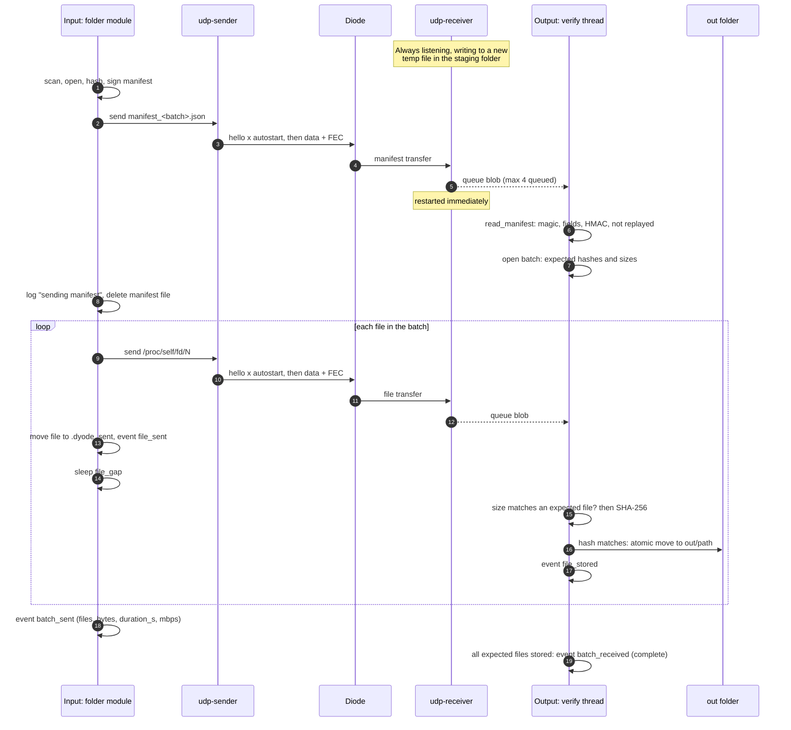

If `udp-sender` exits non-zero for a file, the input box logs
`aborting batch; N file(s) left for the next batch`. Those files were never
moved out of `in`, so the next scan sends them again in a new batch.

### Output side: receive and verify

`udp-receiver` runs in a loop and never waits for verification: a finished
transfer is put on a queue (at most 4 waiting) and the receiver is started
again straight away, because the sender cannot be asked to pause. A
separate verify thread does the rest.

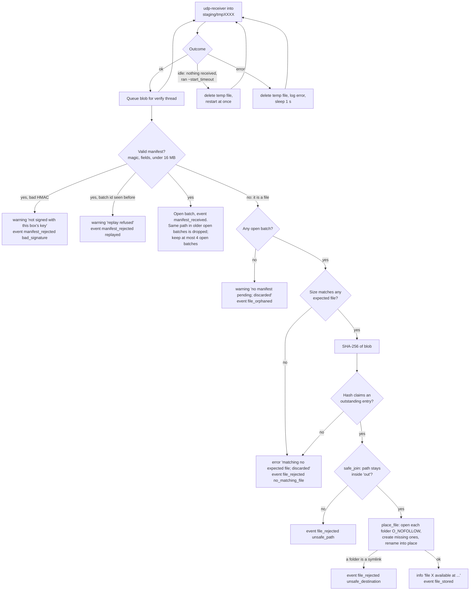

Points worth knowing:

- **Files are matched by content, not by order.** A blob's own SHA-256
  decides which manifest entry it is. A lost transfer costs only that file;
  it cannot shift the rest of the batch.
- **Unlisted files are discarded.** A blob whose size and hash match no
  outstanding entry in any open batch is deleted. This is also what makes an
  unauthenticated `udp-receiver` safe: a file only lands in `out` if a
  signed manifest names its SHA-256.
- **Staging is outside `out`.** By default it is `<out>.incoming`, a sibling
  on the same filesystem, so the final rename is atomic and nothing serving
  `out` ever sees a partial file. Leftovers in staging are deleted at start.
- **Replay protection** only applies when authentication is on, and it is
  in memory (the last 1024 batch ids).

### Batch lifetime on the output box

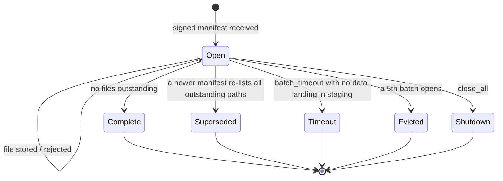

When a batch closes for any reason other than `complete`, each missing file
is named: `file <path> never arrived (batch <id>, <reason>)`, with a
`file_missing` event, then `batch_received` with the counts. Data still
arriving in staging keeps every open batch alive (since 1.4.3), so a long
single transfer is not timed out under itself.

### Retry and recovery on the input box

`udp-sender` exiting 0 only means "transmitted". Sent files are therefore
moved to `in/.dyode_sent/<path>` and kept for `keep_sent_hours` (default
24) rather than deleted. To re-send a file reported as `never arrived`, copy
it from `.dyode_sent` back into `in`. With `keep_sent_hours: 0` sent files
are deleted.

### Receive tuning (writeback)

Large, fast transfers need the receiving box to keep reading the socket
without pauses. `install.sh` writes `/etc/sysctl.d/90-dyode-receive.conf` on
receiving boxes:

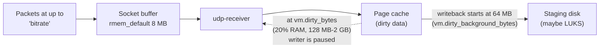

Without it, Linux wrote ~30 s of data in one burst, `udp-receiver` stalled,
its socket buffer overflowed, and udpcast aborted the file. When a transfer
stalls, DYODE reads the kernel's `Udp RcvbufErrors` counter before and after
and says which case it was: a receive-buffer overflow on this box (apply
`sudo ./install.sh --tuning-only`), or packets lost before the box (NIC,
cabling, diode). See [CAVEATS](https://github.com/nc-intezra/dyode_python3/blob/master/CAVEATS.md).

## Modbus mirroring flow

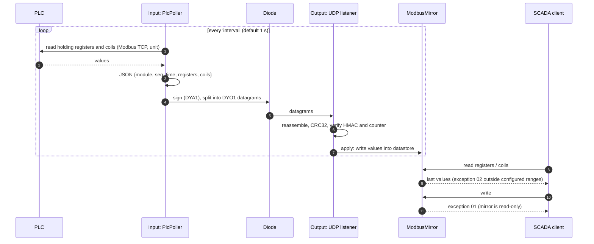

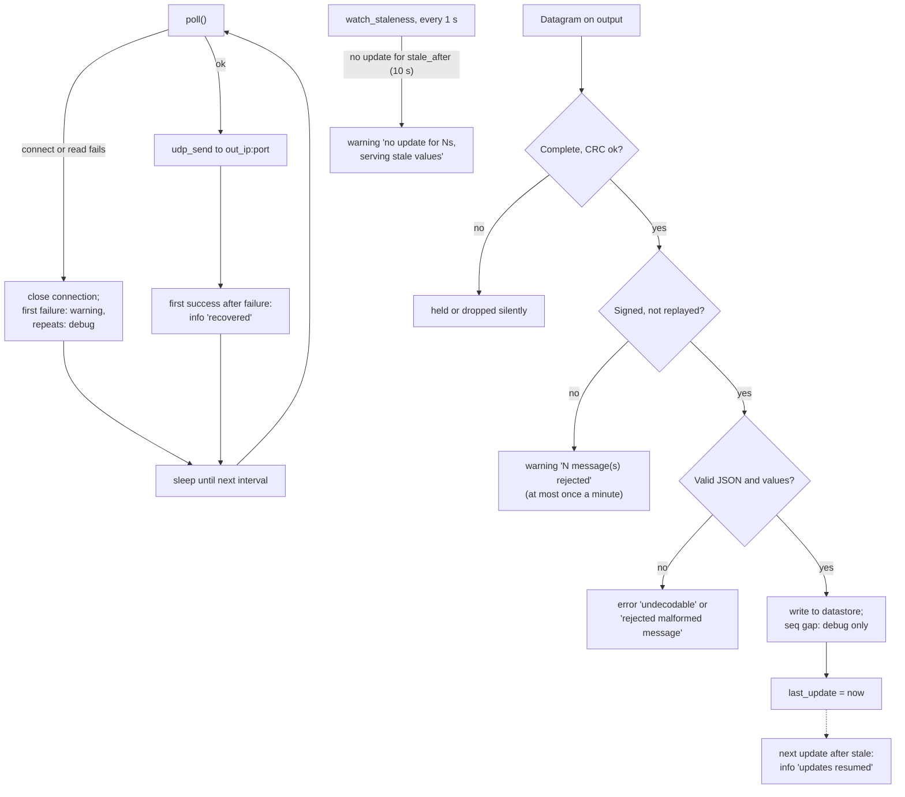

The server keeps answering with the last values it received while updates
are missing; clients cannot tell. The log warning is the only signal. Values
whose start address falls outside the output box's datastore are ignored
with a warning (`Do both config.yaml files match?`). See
[Modbus Mirroring](Modbus-Mirroring).

## Log streaming flow

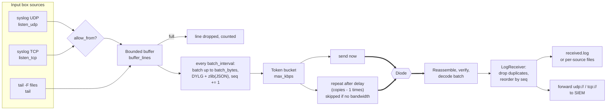

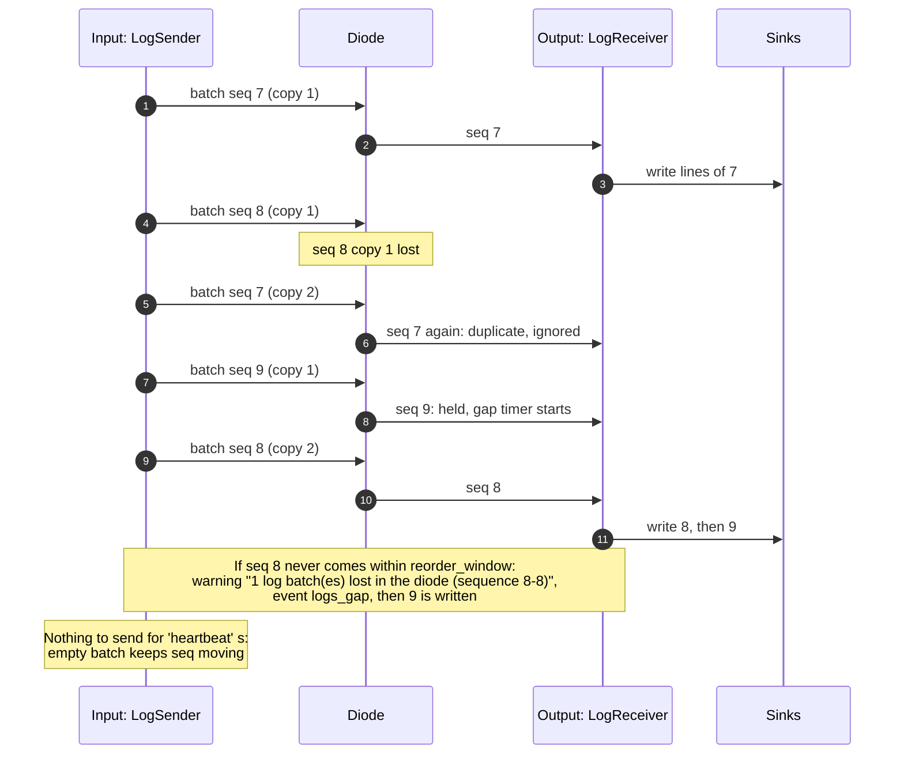

- Each batch carries the sender's boot id, its sequence number, and how
  many lines the input box has dropped so far. A new boot id means the
  input side restarted (`logs_sender_restart`); a rise in the dropped count
  is reported on the output box as `input side dropped N line(s)`.
- With no batch or heartbeat for `stale_after` (default 3 x `heartbeat`),
  the output box logs `no log batches or heartbeats for Ns` (`logs_stale`),
  and `log stream resumed` (`logs_resumed`) when data returns.
- Both sides write `logs_stats` events every 60 s.

See [Log Streaming](Log-Streaming).

## Screen sharing flow

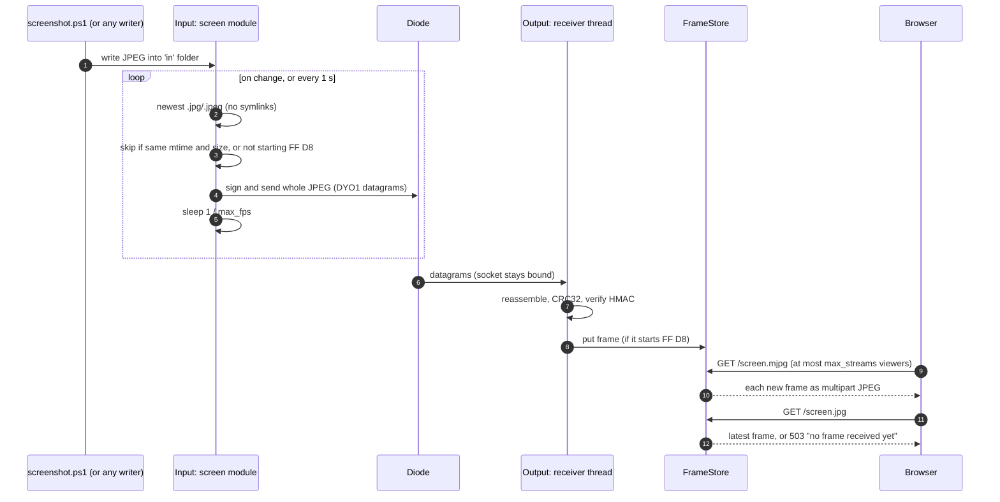

Only the newest frame is kept; there is no frame history or sequence
number. A frame with any lost datagram is simply dropped and the next one
replaces it. The viewer page listens on `http_bind`, by default the first
address that is not on the diode NIC. See [Screen Sharing](Screen-Sharing).

## Error and loss handling

A diode has no return path, so nothing is ever re-requested. Each flow
either repairs loss in advance (FEC, duplicate copies) or reports it.

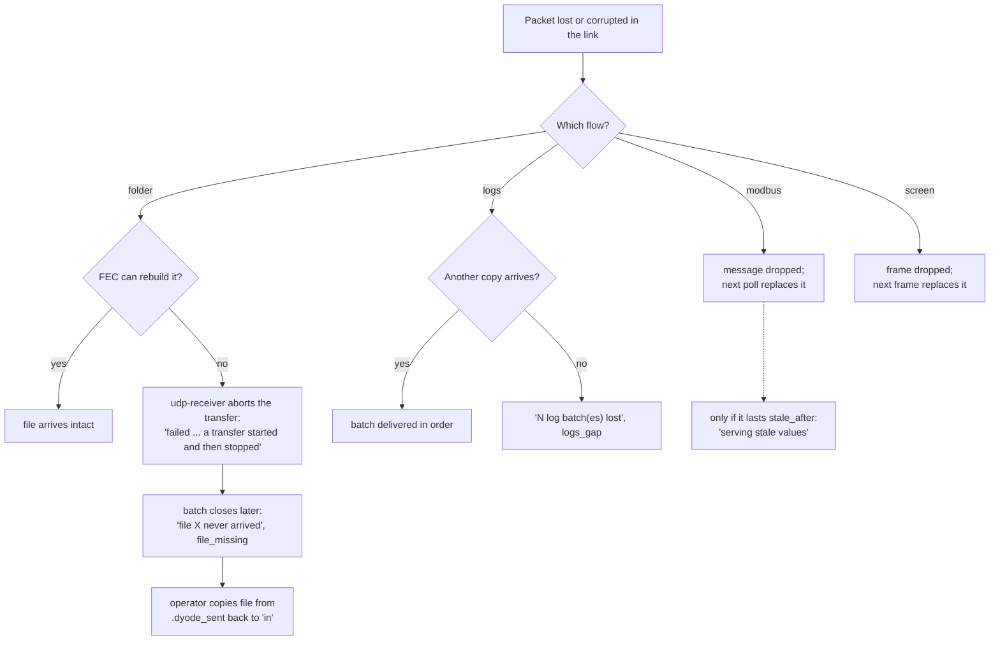

### What each side logs

| Situation | Input box | Output box |
|---|---|---|
| Config invalid | `configuration error: ...`, exit 1 | same |
| Key file missing (`auth.required`) | `configuration error: no message authentication key ...`, module exits and is restarted | same |
| Static ARP cannot be set | at start: `refusing to start`; later: `static ARP entry is NOT in place` | nothing (it simply receives nothing) |
| Module crash | `module X exited (code N)`, restarted | same |
| udpcast missing | `udp-sender not found: install udpcast` | `udp-receiver not found: install udpcast` |
| Folder: file swapped for a link after the scan | `skipped ...`, `file_skipped` | - |
| Folder: `udp-sender` fails on manifest | `udp-sender failed (exit N)`, `batch_failed` | - |
| Folder: `udp-sender` fails on a file | `aborting batch; N file(s) left for the next batch` | batch later closes with `file_missing` |
| Folder: quiet link | - | once at info: `udp-receiver idled out ... normal`, then debug |
| Folder: receiver exits early | - | `udp-receiver failed ... exited before its start timeout; check the interface, port and permissions` |
| Folder: transfer stalls | - | `udp-receiver failed ... a transfer started and then stopped` plus the receive-buffer hint |
| Folder: forged / replayed manifest | - | `manifest_rejected` (`bad_signature` / `replayed`) |
| Folder: unlisted or damaged file | - | `matching no expected file; discarded`, `file_rejected` |
| Folder: file with no open batch | - | `no manifest pending; discarded`, `file_orphaned` |
| Folder: unsafe path or symlinked folder | - | `file_rejected` (`unsafe_path` / `unsafe_destination`) |
| Folder: files never arrived | - | `file X never arrived`, `file_missing`, `batch_received` |
| Modbus: PLC unreachable | `module X: ...` once, `recovered` later | `no update for Ns, serving stale values` |
| Modbus: client write | - | `Modbus client write refused` (at most once a minute) |
| Logs: buffer full | `buffer full, N line(s) dropped so far` | `input side dropped N line(s)`, `logs_dropped_at_source` |
| Logs: batches lost | - | `N log batch(es) lost in the diode`, `logs_gap` |
| Logs: silence | - | `no log batches or heartbeats`, `logs_stale` |
| Any signed module: unsigned or replayed message | - | `N message(s) rejected: not signed with this box's key, or replayed` |
| Screen: too many viewers | - | `viewer X refused: N streams already open` |

Lines are written to `logging.dir`/`human` (and stderr); the JSON events
(`file_sent`, `batch_received`, `logs_gap`, ...) go to `logging.json`. See
[Operations and Monitoring](Operations-and-Monitoring).
